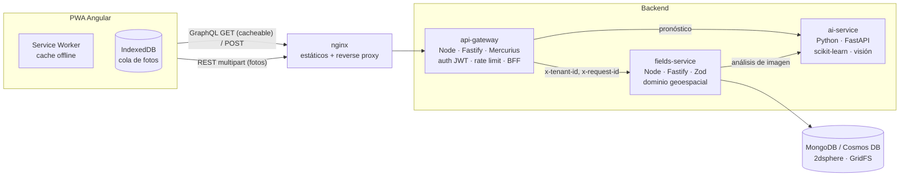

# AgroLens

Plataforma AgTech para **mapear lotes, analizar fotos de cultivos con IA y estimar rendimiento**. Está pensada para usarse desde el celular en zonas rurales con poca conectividad.

Es un proyecto full-stack de demostración construido para la vacante **Desarrollador Fullstack Node.js / Angular — Croper**.

| Requisito de la vacante | Dónde está en el proyecto |
|---|---|
| Node.js, REST y GraphQL | `services/api-gateway` (GraphQL con Mercurius y proxy REST) y `services/fields-service` (REST con OpenAPI) |
| Microservicios | 3 servicios independientes, cada uno con su propio contrato, health checks e imagen Docker |
| Angular, mobile-first y performance | `apps/web`: Angular 22 zoneless, signals, lazy loading, PWA offline y compresión de imágenes en el cliente |
| Imágenes, mapas y datos geoespaciales | GeoJSON, índices `2dsphere`, consultas por viewport (`bbox`) y cercanía (`near`), Leaflet con dibujo de polígonos, análisis de fotos (índice ExG) |
| Python y modelos predictivos | `services/ai-service`: FastAPI y scikit-learn (Gradient Boosting con cuantiles P10/P50/P90) |
| SQL y NoSQL | MongoDB (compatible con Cosmos DB vCore) para la operación y SQLite para el dataset de entrenamiento |
| Cloud y CI/CD | Docker multi-stage, GitHub Actions (tests contra Mongo real y build/push a GHCR), despliegue a Azure Container Apps con OIDC |

---

## Probar sin instalar nada (GitHub Codespaces)

En el repositorio en GitHub: **Code → Codespaces → Create codespace on main**. El stack se construye y se levanta solo (unos 5 minutos la primera vez) y la app se abre en el puerto **8080** con lotes de ejemplo.

## Arranque rápido

```bash
docker compose up --build                       # http://localhost:8080
docker compose --profile seed run --rm seed     # (opcional) carga 7 lotes de ejemplo en Antioquia
```

| URL | Qué es |
|---|---|
| http://localhost:8080 | App web (PWA) |
| http://localhost:4000/graphiql | Explorador GraphQL |
| http://localhost:8000/docs | OpenAPI del servicio de IA |

### Instalación en Windows

```powershell
powershell -ExecutionPolicy Bypass -File .\setup.ps1   # instala Node, Angular y Python y entrena el modelo
```

### Sin Docker (desarrollo)

Requisitos: Node 22.22.3 o superior, Python 3.12 y MongoDB local.

```bash
npm install                                   # servicios Node (npm workspaces)
cd services/ai-service && python -m venv .venv && .venv/Scripts/activate   # Linux/mac: source .venv/bin/activate
pip install -r requirements-dev.txt && python -m scripts.train && uvicorn app.main:app --port 8000
npm run dev:fields                            # :4001
npm run dev:gateway                           # :4000
cd apps/web && npm install && npm start       # :4200 (proxy hacia :4000)
```

### Tests

```bash
npm test                                      # gateway y fields-service (Vitest)
MONGO_TEST_URI=mongodb://localhost:27017 npm test -w services/fields-service   # misma suite contra Mongo real
cd services/ai-service && pytest --cov        # Python
cd apps/web && npm test                       # Angular (Vitest)
```

---

## Arquitectura



**Flujo de una foto:** la app comprime la foto (de unos 4 MB a unos 200 kB) y la envía por `POST /api/v1/fields/:id/observations`. El gateway inyecta el tenant verificado y pasa la petición a fields-service. Este llama a ai-service (índice ExG, cobertura y estrés), guarda la imagen y la observación, y actualiza el resumen del lote. Sin conexión, la foto queda en IndexedDB y se envía sola al reconectar.

**Flujo de un pronóstico:** `field.yieldForecast(rainfallMm, avgTempC)` en GraphQL compone los datos del lote (cultivo, área, pH y la **cobertura de la última foto**) con el modelo predictivo, y devuelve un **rango P10–P90**, no un número único.

Más detalle en [docs/architecture.md](docs/architecture.md) y en las decisiones de diseño ([ADRs](docs/adr)).

---

## Decisiones técnicas clave

| Decisión | Por qué |
|---|---|
| **Gateway BFF con GraphQL y servicios internos REST** | GraphQL le da a la UI exactamente los campos que necesita (menos bytes en 3G) y permite componer servicios. REST con OpenAPI entre servicios es simple, cacheable y fácil de versionar. Las imágenes van por REST porque son binarios. |
| **Queries GraphQL por GET** | El service worker puede cachearlas: la lista de lotes funciona offline. Las mutaciones y los pronósticos van por POST y nunca se cachean. |
| **Multi-tenant desde el día 1** | Cada consulta se filtra por `tenantId`. El tenant sale de un claim del JWT verificado en el borde, nunca de un header que controle el cliente (el gateway sobrescribe `x-tenant-id`). |
| **Área y centroide calculados en el servidor** | Se valida la topología (polígonos auto-intersectados devuelven 422 con un mensaje claro). El cliente nunca puede enviar un área inconsistente. |
| **Paginación por cursor (keyset)** | El costo es O(limit) a cualquier profundidad y las páginas no se desplazan cuando entran datos nuevos. |
| **Rango de predicción, no un punto** | Los agricultores planean en función del riesgo. Se usan tres modelos cuantílicos y el artefacto lleva versión y métricas propias. |
| **Errores RFC 9457 (`problem+json`)** en REST y `extensions.code` estable en GraphQL | Los clientes manejan los errores por código, no por texto. |
| **Config validada con Zod/Pydantic al arrancar** | Si falta configuración, el contenedor falla al iniciar y no en la primera petición. `AUTH_MODE=none` está prohibido en producción. |
| **Sin Apollo ni NgRx en el front** | Un cliente GraphQL de unos 60 líneas y signals bastan. Bundle inicial de **unos 77 kB gzip**. Leaflet y el editor de polígonos se cargan bajo demanda. |
| **Una suite de tests, dos backends** | Los tests de API corren en memoria (rápidos) y en CI también contra MongoDB real (índices y operadores geo). |

---

## Pensado para el campo (performance y offline)

- Bundle inicial de unos **77 kB gzip**. Cada pantalla y el mapa se cargan con lazy loading, y el CSS de Leaflet solo se descarga donde hay un mapa.
- PWA: app shell en caché, lotes consultados disponibles sin señal, teselas del mapa y fotos en caché.
- **Cola offline de fotos** en IndexedDB que se reintenta al volver la conexión. Un indicador muestra cuántas fotos quedan por enviar.
- Compresión de fotos en el cliente con `createImageBitmap` y `OffscreenCanvas` (respeta la orientación EXIF).
- Canvas renderer en Leaflet (`preferCanvas`), mejor en Android de gama baja.
- Alto contraste para leer bajo el sol, objetivos táctiles de 44 px o más, fuentes del sistema (sin descargar webfonts) y UI en español (es-CO).

## Seguridad

Helmet, CORS con lista blanca y rate limit por tenant. JWT (RS256/ES256) verificado contra JWKS, con issuer y audience. Límites de tamaño en uploads y en el body, y allowlist de MIME. Pillow protegido contra decompression bombs. Límite de profundidad en queries GraphQL. Contenedores sin root y con `tini`. Logs JSON que ocultan `authorization` y `cookie`. Headers CSP en nginx.

## Observabilidad

Un `x-request-id` viaja por web → gateway → fields → ai, y aparece en cada línea de log (JSON). Hay health checks `live` y `ready` en todos los servicios: `ready` verifica dependencias, así que el orquestador retiene el tráfico si Mongo o el modelo no están listos.

---

## IA como copiloto

Este proyecto se construyó usando IA (Claude) como copiloto de desarrollo, que es la forma de trabajo que describe la vacante:

- **Diseño:** discutir trade-offs (GraphQL vs REST por tipo de tráfico, cuantiles vs intervalo bootstrap, Leaflet vs mapas WebGL para gama baja) y dejar registro en los ADRs.
- **Implementación:** generar el andamiaje y revisar cada pieza con criterio propio. Por ejemplo, la IA propuso inicialmente ExG puro para la vegetación; los tests mostraron que clasificaba el follaje amarillo como verde, y se corrigió exigiendo dominancia del canal G.
- **Tests primero en lo crítico:** aislamiento de tenants, topología inválida, límites de upload, timeouts, contratos entre servicios.
- **Verificación E2E** con Playwright en viewport de móvil (Pixel 7): dibujar un lote, subir una foto, calcular el pronóstico y probar el modo offline.

La IA acelera, pero las decisiones, la revisión y la responsabilidad sobre la calidad son humanas.

---

## Estructura

```
apps/web/                 Angular 22 PWA (nginx en producción)
services/api-gateway/     BFF: GraphQL, auth, rate limit, proxy REST
services/fields-service/  Lotes, geometrías, observaciones (MongoDB + GridFS)
services/ai-service/      FastAPI: pronóstico de rendimiento + análisis de imágenes
docs/                     Arquitectura, ADRs, despliegue en Azure
.github/workflows/        CI (tests + imágenes) y CD (Azure Container Apps)
```

## Próximos pasos (roadmap)

- Imágenes satelitales (Sentinel-2, NDVI real) cruzadas con las fotos de campo.
- Datos climáticos reales (IDEAM / Open-Meteo) para alimentar el pronóstico de forma automática.
- Event bus (Azure Service Bus) para procesar las fotos de forma asíncrona cuando el volumen crezca.
- Registro de modelos (Azure ML / MLflow) y reentrenamiento con cosechas reales.
- OpenTelemetry para trazas distribuidas en Application Insights.
